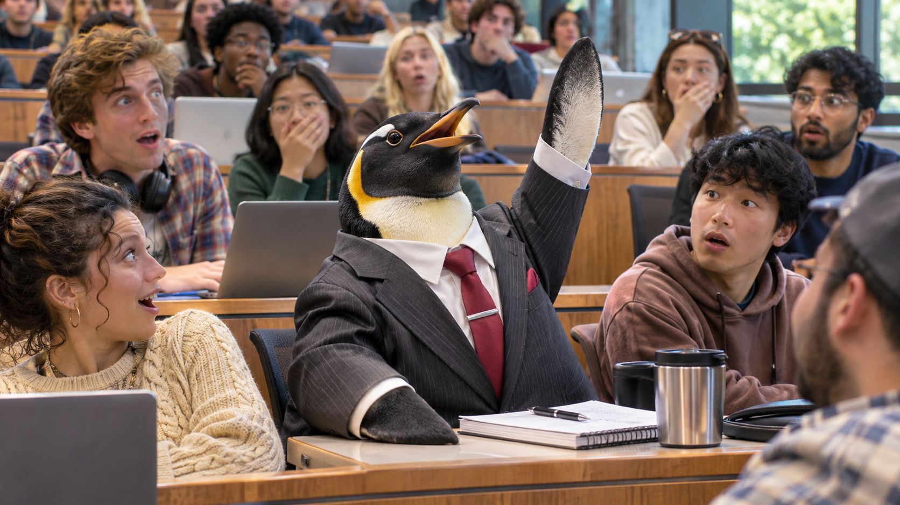
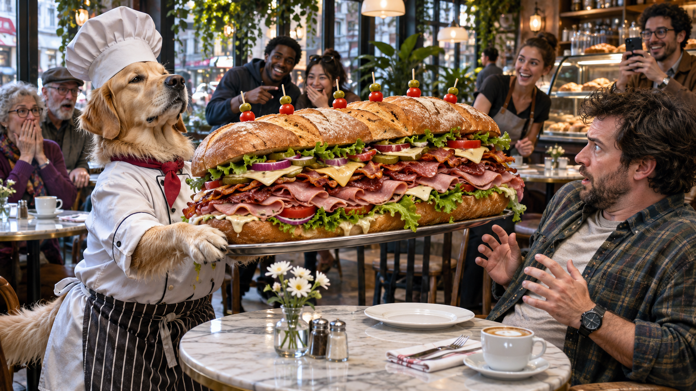
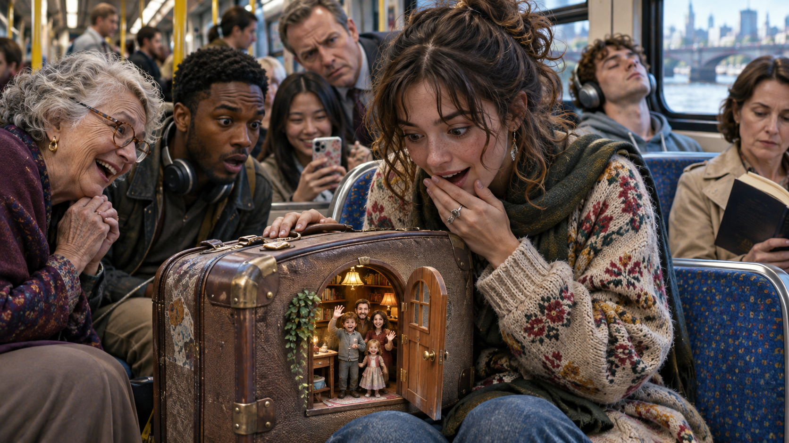
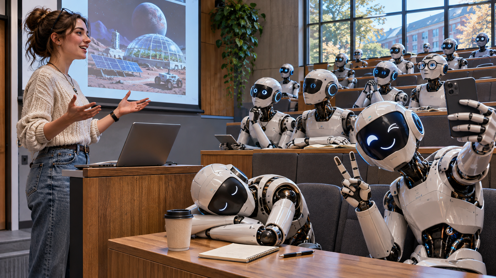
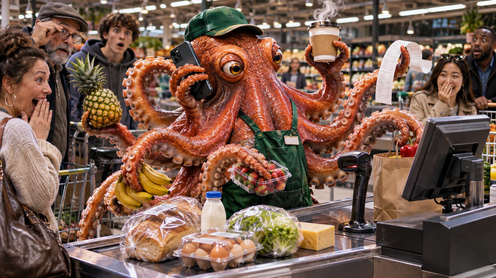

# College English: When Ordinary Life Gets Weird

**Two hours · Conversation, observation and imagination · Intermediate English**

Students describe scenes, speculate, ask follow-up questions, explain opinions and tell stories. You need the five pictures below, a board, paper and a timer. Students work in pairs and small groups.

| Time | Activity |
| --- | --- |
| 0–10 minutes | Warm-up: Would you rather? |
| 10–20 minutes | Useful language and mini-practice |
| 20–50 minutes | Five picture conversations |
| 50–65 minutes | Teacher-led conversation around the room |
| 65–75 minutes | Break |
| 75–90 minutes | The story behind the picture |
| 90–105 minutes | Role-play: This is getting weird |
| 105–115 minutes | Agree, disagree, or it depends |
| 115–120 minutes | Exit ticket |

## Warm-up: Would you rather? — 10 minutes

In pairs, choose an answer, explain why and ask a follow-up question. Invite pairs to share a surprising answer.

1. Would you rather have a penguin as a professor or a dog as your boss?
2. Would you rather be able to talk to animals or understand every human language?
3. Would you rather accidentally send an embarrassing message to your whole class or wave at someone who wasn’t waving at you?
4. Would you rather give a presentation wearing pajamas or sing your introduction?
5. Would you rather live without your phone for a month or without your favorite food for a month?
6. Would you rather know what everyone is thinking or never have to take another exam?
7. Would you rather be famous for something wonderful or something ridiculous?
8. Would you rather always arrive 20 minutes early or always arrive 10 minutes late?

Follow up: Why did you choose that? What would be the best part? What could go wrong? Would your answer change if you had to do it for a whole year?

## Useful language — 10 minutes

| Purpose | Expressions |
| --- | --- |
| Describe | “In the foreground, I can see…” / “In the background, there are…” |
| Suggest | “Maybe…” / “It looks as if…” / “They might be…” |
| Give a reason | “I think that because…” / “One possible explanation is…” |
| Ask more | “What makes you think that?” / “What happened next?” |
| Respond | “That’s a good point.” / “I see it differently because…” |
| Imagine | “If I were there, I would…” / “I wonder what would happen if…” |

**Quick practice:** Tell students: “A person is carrying an umbrella indoors.” In pairs, give one observation, one possible explanation and one question. Share explanations and distinguish what students see from what they imagine.

## Five picture conversations — 30 minutes

Spend about six minutes per picture: 30 seconds to look silently, about four minutes for pairs to discuss, then share answers and a funny caption. Choose questions that get the class talking; students need not answer all of them.

### 1. The unexpected student

1. What do you see? Describe three details.
2. How are the other students reacting?
3. What question do you think the penguin wants to ask?
4. Why might the penguin be wearing a suit?
5. What subject is the class studying? What makes you think so?
6. What happened five minutes before this picture?
7. Would the penguin be a good classmate? Why or why not?
8. What would you say if the penguin sat next to you?
9. What might the professor say next?
10. Give the picture a funny title.

### 2. The chef’s special

1. Describe the customer’s expression. What might he be thinking?
2. What ingredients can you see?
3. Why do you think the sandwich is so enormous?
4. How much should this sandwich cost? Explain.
5. Would you eat it? Why or why not?
6. What is the dog chef proud of?
7. What would be a good name for the restaurant?
8. What could go wrong if the customer tries to eat the sandwich alone?
9. What might an online review of this restaurant say?
10. Invent one line of dialogue for the chef and one for the customer.

### 3. The suitcase surprise

1. Where are the people, and what unusual thing can you see?
2. How do you think the traveler feels?
3. Who might the tiny people be?
4. How did they get into the suitcase?
5. What might they need from the traveler?
6. Where could they be traveling?
7. What problems would you face if you were very small?
8. If you found them, what would you do first?
9. Would you tell the other passengers or keep the discovery secret? Why?
10. What should happen next?

### 4. A very unusual audience

1. What is the person doing?
2. Describe two things you notice about the audience.
3. What might the presentation be about?
4. How does the presenter probably feel? Why?
5. What questions might the robots ask afterward?
6. Would you rather present to robots or humans? Explain.
7. What makes a presentation interesting?
8. What should a speaker do when the audience seems bored?
9. If one robot interrupted, what might it say?
10. Give the presentation a surprising title.

### 5. The busiest cashier

1. What is happening in this supermarket?
2. What tasks is the cashier trying to do?
3. What might the customers be thinking?
4. Would having eight arms make this job easier? Why?
5. What other job might an octopus be excellent at?
6. What job might be difficult for an octopus?
7. Is the cashier having a good day or a stressful day? What clues do you see?
8. What would you say if this cashier helped you?
9. Imagine the cashier’s job interview. What questions were asked?
10. Create a short advertisement for the supermarket.

## Teacher-led conversation around the room — 15 minutes

Spend three minutes on each topic. Give everyone 15 seconds to rehearse with a neighbor. Ask three to five students from different parts of the room, ask a follow-up after each answer, then invite a classmate to respond. In the last 30 seconds, partners compare answers. Students may say “come back to me”; return after they have rehearsed.

1. **A penguin joins the class.** What would you ask it? What would it be good at? What funny rule might it suggest? Ask: “What makes you think that?”
2. **The strange restaurant.** What is the strangest restaurant you can imagine? What is on the menu? Would you take a friend? Ask: “Who would order something different?”
3. **Small enough for a suitcase.** Where would you explore? Which ordinary object would be useful? What might be dangerous or funny? Ask: “How would you solve that?”
4. **A robot in your life.** What job would you give a robot? What should it never do for you? What if it misunderstood an instruction? Ask: “Does anyone have a different idea?”
5. **Eight arms for a day.** What would you do? Which job would become easier? What funny mistake could you make? Ask: “Would you keep the eight arms? Why?”

## Break — 10 minutes

Optional question: Which picture would make the best movie? What would you call it?

## The story behind the picture — 15 minutes

In groups of three or four, choose a picture and create a story. Each person contributes an idea. Allow eight minutes to prepare and seven to share with another group or the class.

1. Who are the main characters? Where are they?
2. What was happening before the picture?
3. What unexpected problem appeared?
4. What does each character want?
5. What does someone say?
6. How do the characters solve the problem?
7. What is the final surprise?

Story starters: “It was an ordinary morning until…” “Nobody expected…” “Suddenly…” “At first, they thought…” “Unfortunately…” “In the end…” “The biggest surprise was…”

Audience questions: What was your favorite detail? What would you change about the ending? What question would you ask a character?

## Role-play: This is getting weird — 15 minutes

In pairs, choose a situation, prepare for three minutes and perform for another pair. Switch roles or choose another situation. After each role-play, the audience asks: “What happened after that?”

**The penguin and the professor:** The penguin wants to join the class. Why does it want to study this subject? What experience does it have? What rules might be difficult? Should the professor accept it?

**The customer and the dog chef:** The customer ordered a small lunch. What does the customer say? How does the chef explain the meal? Can they agree on a solution? Does the customer leave a good review?

**The traveler and the tiny person:** How did the tiny person get into the suitcase? Where do they want to go? What help do they need? What agreement can they make?

**The presenter and a robot:** What is the presentation about? Why does the robot interrupt? Does the presenter answer? How does the audience react?

Useful phrases: “Excuse me, but could you explain…?” “I understand, but there’s a problem.” “What if we…?” “That could work.” “I have a better idea.”

## Agree, disagree, or it depends — 10 minutes

Read a statement. Students choose agree, disagree or it depends, discuss their reasons in small groups, and share different viewpoints. Encourage them to respond to one another.

1. Animals would make better coworkers than humans.
2. It is better to be funny than serious in a presentation.
3. Everyone should have to work in customer service at least once.
4. A good teacher should always know the answer.
5. Technology makes communication easier.
6. People should be allowed to bring pets to college.
7. A surprising experience is more valuable than a perfect plan.
8. It is better to ask a silly question than stay confused.
9. The best meals are the ones shared with other people.
10. Being able to laugh at yourself is an important skill.

Follow up: Why do you think that? Can you give an example? Does anyone have a different opinion? When might the opposite be true? Has anyone changed their mind?

## Exit ticket — 5 minutes

1. Which picture was your favorite? Why?
2. Write one sentence about a picture using **might** or **could**.
3. Write one question you would like to ask a character from a picture.
4. What is one useful English expression you used or heard today?
